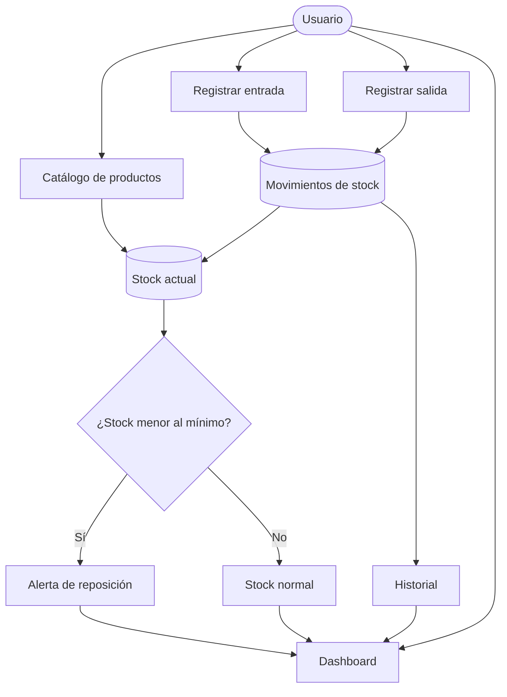

# PROYECTO
StockFlow; sistema de gestión de inventarios

software que permita a un negocio saber qué productos tiene, cuánto stock posee, qué movimientos ocurrieron y qué necesita reponer, manteniendo toda esa información consistente.
No sería simplemente una lista de productos. Sería un pequeño sistema que administra el estado y los movimientos de un inventario.

## Estructura 
Funcionalidad general


#Funcionalidad general

```mermaid
flowchart TD
    A([Inicio]) --> B[Usuario elige producto, tipo, cantidad y motivo]
    B --> C{¿Producto activo?}
    C -- No --> X1[Error: producto inactivo]
    C -- Sí --> D{¿Es una salida?}
    D -- No --> F
    D -- Sí --> E{¿Hay stock suficiente?}
    E -- No --> X2[Error: stock insuficiente]
    E -- Sí --> F[Iniciar transacción]
    F --> G[Guardar movimiento]
    G --> H[Actualizar stock]
    H --> I{¿Todo salió bien?}
    I -- No --> J[Revertir cambios]
    I -- Sí --> K[Confirmar transacción]
    K --> L{¿Stock menor al mínimo?}
    L -- Sí --> M[Marcar para reposición]
    L -- No --> N([Fin])
    M --> N
    J --> X3[Error: no se registró nada]
 ```
# El dueño actualmente lleva el inventario en Excel y tiene problemas:
- No sabe exactamente cuántas unidades tiene de cada producto.
- Se olvida de registrar las ventas o reposiciones.
- Compra mercadería que ya tiene.
- Se queda sin productos que tienen mucha demanda.
- No sabe cuáles son los productos que más se mueven.
- Cuando encuentra diferencias en el stock, no sabe por qué ocurrieron.
   
